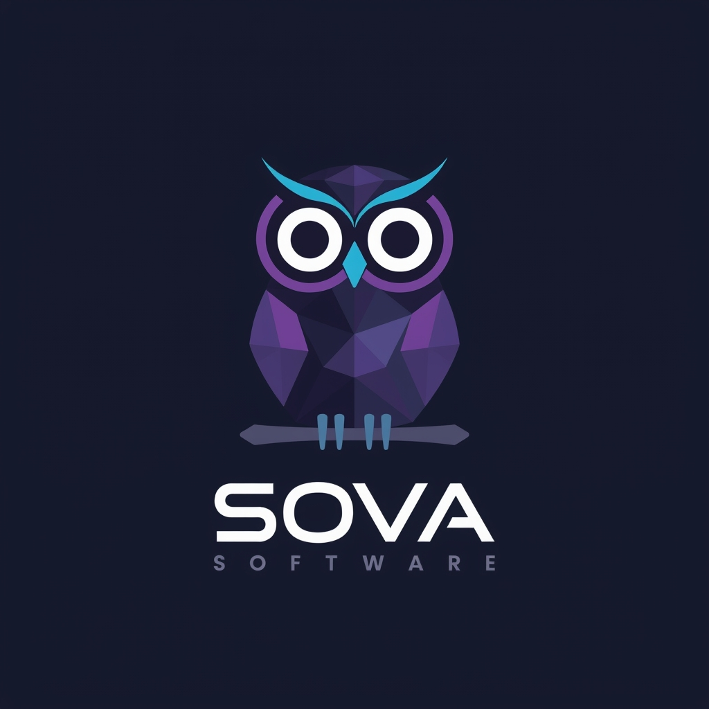

# SOVA: Software Orchestration Via Agents

<p align="center">
  
</p>

[](https://github.com/xsovad06/sova/actions/workflows/ci.yml)
[](LICENSE)
[](https://python.org)

## What is SOVA?

SOVA is a standalone application that turns GitHub Issues into merged pull requests, autonomously. Install it into any software project and it will triage issues, research the codebase, develop solutions using TDD, self-review, create PRs, monitor CI, and address review feedback. You stay in control through a web dashboard and a human-in-the-loop handoff system, while SOVA handles the repetitive engineering work.

## Why SOVA?

- **End-to-end automation**: from issue triage to merged PR, SOVA handles the full development cycle. You approve, it executes.
- **Quality by design**: gate checks between every pipeline step catch problems early. Agents refuse to work on issues that haven't been properly triaged and researched.
- **Learns from mistakes**: lessons are kept as markdown in `.claude/agent-memory/`, captured through the human-reviewed `/extract-knowledge` command, and `sova retro` measures how often review findings repeat a recorded rule.
- **You stay in control**: agents are ephemeral (spawn, work, handoff, exit). The dashboard shows what they did, what they need, and lets you decide when to merge. Nothing ships without your approval.
- **Works on any project**: install once, configure with `sova config set` or the dashboard, and SOVA detects your stack from marker files (Django, FastAPI, Odoo, and more).

## Key Features

- **Role-Based Agents**: specialized triage, researcher, developer, and reviewer roles with automatic dispatch and autonomous Developer-Reviewer chaining
- **Gate-Checked Pipeline**: every step validates its output before the next begins; Developer pipeline (18 steps), Address-Review pipeline (13 steps)
- **Web Dashboard**: 24-page UI for monitoring runs, costs, agent control, lifecycle tracking, and configuration
- **24/7 Server Mode**: scheduler with a priority-based watch loop; `sova parallel` runs several issues concurrently
- **Handoff System**: per-issue handoff files eliminate race conditions in parallel agent runs; dashboard renders action buttons for human decisions
- **28 Standardized Commands**: develop, test, review, PR, ship, debug, and more. Works on any project
- **Markdown Knowledge System**: project rules plus agent memory captured via `/extract-knowledge`, and a review retro (`sova retro`) that tracks repeated findings ([details](knowledge/KNOWLEDGE.md))
- **Stack Detection**: detects your tech stack from marker files and shows it on the Settings page
- **Pluggable Task Sources**: GitHub Issues and Jira Cloud supported, Linear planned

## Architecture Overview


Each transition is enforced by gate checks. The Developer refuses issues that haven't been triaged and researched first (use `--force` to bypass for quick fixes).

## Requirements

- Python 3.12+
- [Claude Code CLI](https://docs.anthropic.com/en/docs/claude-code) (`claude`)
- [GitHub CLI](https://cli.github.com/) (`gh`): authenticated
- `git` with configured identity: `git config user.name` and `git config user.email`
- `terminal-notifier` (macOS, optional): `brew install terminal-notifier` for rich desktop notifications with custom icon and sound

## Installation

```bash
git clone https://github.com/xsovad06/sova.git
cd sova
pip install --user -e .
```

Ensure your Python user bin directory is on `PATH`:

```bash
# macOS (replace 3.12 with your Python version)
export PATH="$HOME/Library/Python/3.12/bin:$PATH"

# Linux
export PATH="$HOME/.local/bin:$PATH"
```

For Vertex AI support (Google Cloud ADC for LLM suggestions and batch processing):

```bash
pip install --user -e ".[vertex]"
```

For development (tests, linting), `make sync` installs exactly the versions CI tests (`uv.lock`; needs [uv](https://docs.astral.sh/uv/)), or install the newest versions in range:

```bash
pip install --user -e ".[dev]"
```

SQLite (`.claude/sova.db`) is the database backend CI tests. PostgreSQL (`SOVA_DATABASE_URL` with the `postgres` extra) is **experimental**: no CI job runs against it.

`sova --version` reports the version derived from the nearest `vX.Y.Z` git tag (a build between tags carries a `.dev` suffix); release notes are in [CHANGELOG.md](CHANGELOG.md).

## Quick Start

```bash
# Install SOVA into your project (creates database config, deploys commands)
sova install /path/to/project

# Optional: run the interactive setup wizard for custom configuration
sova setup /path/to/project

# Triage an issue to assess agent suitability
sova triage 42

# Work on an issue (runs the full pipeline: develop, test, review, PR)
sova run 42

# Or start the server for fully autonomous operation
sova server start
```

## Claude Code

SOVA drives the [Claude Code CLI](https://docs.anthropic.com/en/docs/claude-code) by default. Sign it in with your Claude subscription, then confirm with `sova doctor`:

```bash
claude auth login
sova doctor
```

On a machine with no browser, use `claude setup-token`. The [AI Provider Setup Guide](docs/ai-provider-setup-guide.md) covers both logins, API-key and Vertex AI alternatives, and troubleshooting. To run pipeline steps through OpenAI's Codex CLI instead, set `agent.runtime = "codex"` (see the [Codex Runtime Setup Guide](docs/codex-runtime-setup.md)).

## Dashboard

```bash
sova dashboard --project /path/to/project    # http://localhost:8111
```

The Work page shows what is running, what needs you and what to start next. Other pages cover run detail, costs, the batch queue, custom roles and settings, and a phone view works over Tailscale. See [Dashboard](docs/dashboard.md) for every page and the board's stages.

## How It Works

SOVA uses a **role-based architecture** with four specialized agent types:

1. **Triage**: assesses issues for agent suitability, applies labels (`agent:ready`, `agent:needs-spec`, `agent:needs-research`, `agent:interactive-recommended`, `agent:human-only`). `triage.interactive_title_prefixes` and `triage.interactive_labels` are empty by default; set `triage.interactive_title_prefixes = ["[Spike]"]` to classify such titles as `interactive`. `agent:interactive-recommended` blocks autonomous scheduling until a human starts the run.
2. **Researcher**: investigates the codebase and writes an implementation spec
3. **Developer**: implements the solution using TDD, creates a PR, monitors CI
4. **Reviewer**: reviews the PR, posts findings, triggers a fix cycle if needed

Agents are **ephemeral**: each one spawns, does its job, writes a handoff file, and exits. The orchestrator (scheduler or dashboard) reads the handoff and spawns the next agent in the chain. Developer and Reviewer chain autonomously: when the Developer finishes, it hands off to the Reviewer, which hands back to the Developer if findings exist. This loop continues until the code is clean, then SOVA notifies you and waits for your merge decision.

## Documentation

| Topic | Guide |
|-------|-------|
| Every doc, by audience | [docs/README.md](docs/README.md) |
| Dashboard pages and phone access | [docs/dashboard.md](docs/dashboard.md) |
| Configuration and notifications | [docs/configuration.md](docs/configuration.md), [docs/notifications.md](docs/notifications.md) |
| Running the always-on server | [docs/server-operations.md](docs/server-operations.md), [docs/always-on-mac-setup.md](docs/always-on-mac-setup.md) |
| CLI and MCP server | [docs/cli-reference.md](docs/cli-reference.md) |
| LLM providers and Vertex AI | [docs/ai-provider-setup-guide.md](docs/ai-provider-setup-guide.md) |
| Jira as a task source | [docs/jira-configuration-guide.md](docs/jira-configuration-guide.md) |
| Daily briefing (Gmail, Calendar) | [docs/awareness-setup.md](docs/awareness-setup.md) |
| Architecture and roadmap | [docs/ARCHITECTURE.md](docs/ARCHITECTURE.md), [docs/VISION.md](docs/VISION.md) |

## Task Sources

| Source | Status |
|--------|--------|
| GitHub Issues | Supported |
| Jira Cloud | Supported ([configuration guide](docs/jira-configuration-guide.md)) |
| Linear | Planned |

## Marketplace

A subset of SOVA's distributable commands (`develop`, `spec`, `review`, `pr`, `debug`, `test`) is packaged as a standalone Claude Code plugin in [`plugins/sova/`](plugins/sova/), adapted to run in any project without installing SOVA itself. This plugin is intended for publication to the [Claude AI Helpers Marketplace](https://github.com/openshift-eng/ai-helpers); until that PR is submitted and merged, install it directly from this repository:

```bash
/plugin marketplace add xsovad06/sova
/plugin install sova@sova
```

## Contributing

Contributions are welcome. See [CONTRIBUTING.md](CONTRIBUTING.md) for setup, code style, and PR guidelines.

SOVA has no bounty, reward, or paid-contribution program. There is no `/claim`, `/bounty`, or `/reward` command, and no bounty platform is connected to this repository. Pull requests carrying bounty claim syntax are closed automatically (see [No Bounty Program](CONTRIBUTING.md#no-bounty-program)).

```bash
make check    # Lint + test (close to CI; see docs/testing-guidelines.md for what it does not cover)
make test     # All tests (bash + python); `make lint` and `make format` are in CONTRIBUTING.md
```

## Getting Help

- Run `sova doctor` to check your environment, and `sova --help` or `sova <command> --help` for CLI usage
- **Config issues?** See [Troubleshooting Configuration](docs/troubleshooting-config.md) for common errors and fixes
- File an [issue](https://github.com/xsovad06/sova/issues) for bugs or questions

## License

Licensed under the [Apache License, Version 2.0](LICENSE).
